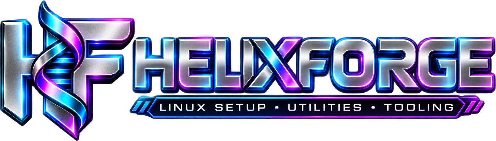

<p align="center">
  
</p>

<p align="center"><strong>BUILD • CONFIGURE • OPTIMIZE</strong></p>

HelixForge is a Linux setup menu for the terminal: a catalog of installers,
configurations and maintenance entries organised in tabs and groups, each run
inside the application after a confirmation, with a record of every run. It is
written in Rust and built so a graphical interface can share the same engine
later.

> Milestones 1 to 4 are complete: HelixForge carries every entry of Commander
> Toolbox, which it replaces, and is tested on Arch, Debian, Ubuntu and
> Fedora. See `docs/ROADMAP.md` for what comes next.

## Run

On Linux x86_64, run the latest release straight from GitHub, as your normal
user:

```sh
curl -fsSL https://raw.githubusercontent.com/Commanderx-code/Helix-Forge/main/start.sh | sh
```

`start.sh` downloads the published build, refuses it when it does not match
the published SHA-256 sum, and installs nothing. With a Rust toolchain (1.88
or newer) it runs from a checkout instead:

```sh
./start.sh                           # or: cargo run -p helixforge
cargo run -p helixforge -- --help    # the command line
```

In the interface the sidebar is a menu of screens. `Tab` or `j`/`k` in the
sidebar move between Dashboard, Applications, Install Plan, and the other
areas, History and Settings; `Enter` or `l` opens the selected screen and
`h` returns to the sidebar. In an area, `j`/`k` or the arrows move in the
list, `Enter` opens a group or runs an entry, `Space` adds it to the install
plan, `d` shows the description, `p` the script or command, `g` explains the
flags column and `/` searches every area. The Install Plan shows what is
queued with its risk and requirements; `Enter` runs it. Each run asks `[Y]`
first and then runs in a terminal inside the window; `Ctrl-C` stops it and
everything it started (if something ignores that, the window says so and a
second `Ctrl-C` kills it), `l` saves its output, and History lists every run.
`?` shows all keys and `q` quits. The menu needs a terminal; the commands
below also work without one.

The menu follows the HelixForge dashboard design: cards for the main screens
and quick actions, with Nerd Font icons. `t` or Settings switches between
three themes: **default** draws over your terminal's own background, so a
wallpaper or transparency shows through; **solid** paints the design's dark
panels; **compatible** keeps to sixteen colours. Settings also turns the icons
off for terminals without a Nerd Font. Both choices are remembered in
`~/.config/helixforge/settings.toml`; `--theme` and `--plain` override them
for one run.

In terminals that show pictures through Kitty's graphics (Ghostty, Kitty) or
Sixel (foot, WezTerm, xterm with Sixel on), the header is the HelixForge
banner. Elsewhere, including Konsole, tmux and the console, with icons off or
in the compatible theme, it is the text header. HelixForge asks the terminal
once at start and waits at most 0.4 seconds for the answer.

From the command line:

```sh
helixforge system                     # the distribution and package manager it sees
helixforge list                       # the catalog as tabs, groups and entries
helixforge info git                   # one entry
helixforge plan git system-report     # what running entries would do
helixforge run git --dry-run          # the plan, nothing changed
helixforge run git                    # runs after you type RUN, asked on the terminal even when piped
helixforge remove ardour              # removes a package entry that offers it
helixforge history                    # recent runs
helixforge docgen docs/walkthrough.md # the catalog as Markdown
```

## The catalog

`catalog/tabs.toml` names the areas: Applications, Configurations, Helix
Doctor, Maintenance, Security and Profiles. Each is a directory with a
`tab.toml`; inside it, entries are `<id>.toml` files and groups are
directories with a `group.toml`. An entry is one of six kinds:

```toml
name = "Ardour"
description = "A digital audio workstation."
flags = "I"                      # what it does; g in the interface explains the codes

[package]                        # tried in order: the family's package, the AUR, Flathub
binary = "ardour"                # installed when this is on the PATH (or its Flatpak is)
debian = "ardour"                # also arch, fedora, suse, alpine, void, solus
fedora = "ardour"
aur = "ardour"                   # Arch, through paru or yay, when arch is not given
flatpak = "org.ardour.Ardour"    # for families with no package
removable = true                 # offer removal: r in the interface, helixforge remove
```

```toml
[script]                         # scripts/installers/system-report.sh, run from its directory
id = "system-report"
interactive = true               # the default; false for scripts that never prompt
```

```toml
[script]                         # or a script beside the entry's TOML file
path = "setup.sh"
```

```toml
[command]                        # an inline shell command
line = "echo hello"
```

```toml
[nix]                            # one of the two
profile_install = "nixpkgs#ripgrep"
home_manager_switch = "~/dotfiles/home-manager#commander"
```

```toml
[native]                         # implemented in Rust by the engine
action = "system-report"
```

```toml
[profile]                        # other entries, as one reviewable plan
entries = ["git", "ripgrep", "fzf", "neovim"]
```

Entries and groups can carry `order` to sort before their name, `multi_select
= false` to keep them out of the queue, and `preconditions` that hide them on
machines they do not apply to:

```toml
[[preconditions]]
matches = true
check = "command_exists"         # or "file_exists", { containing_file = "..." }, { environment = "..." }
values = ["sddm"]
```

Scripts source the shared helpers with `. "$HELIXFORGE_LIB/common-script.sh"`.
The catalog and scripts are embedded into the binary at build time and
unpacked to a private temporary directory when it starts, so scripts run as
real files. The copy is removed on exit; one left behind by a HelixForge that
was killed is removed the next time HelixForge starts.

## Plans

Running entries first makes a plan: the steps in order, what they need,
whether any asks for your password, and the risk from the flags. The
interface shows it in the confirmation; `helixforge plan` and `helixforge run
--dry-run` print it. Every run is recorded with its outcome, including runs
that failed or were interrupted.

A package entry lists every source it has on this machine, in order: the
distribution's package, the AUR on Arch, then Flathub. The plan shows the
first with the others after it (`sudo pacman -S --needed meld  (else
Flathub)`). When a source fails, or finishes without the package being
installed, the run says so and tries the next one; a source whose tool is
missing is skipped. A command stopped with `Ctrl-C` stops the run instead.

After a run, HelixForge checks each package step: an install passes when the
entry's program is on the PATH, its package manager lists the package, or
its Flatpak is installed; a removal passes when the package is gone. The
running window's title says `FINISHED · VERIFIED`, the command line prints a
`Verified:` line for each package, and the history records `exit 0,
verified`. A run whose program succeeded but whose package cannot be found
is recorded as failed, with what was missing.

## Layout

```text
apps/helixforge/            the command line and the terminal interface
crates/helixforge-core/     the data model: tabs, groups, entries, actions, risk
crates/helixforge-catalog/  loading and validating the catalog and scripts
crates/helixforge-platform/ distribution and package manager detection
crates/helixforge-engine/   plans, the shell program, runners, the pseudo-terminal, history
catalog/                    the entries, one TOML file each, in six areas
scripts/shared/             the shell helpers scripts source
scripts/installers/         the scripts by id: commander/ from the previous toolbox, the rest from Linutil's catalog
tests/installers/           the installers' Python tests, run against fixtures
tests/fixtures/             a small catalog for the end-to-end tests
docs/                       architecture, roadmap, security, migration matrix, walkthrough
assets/                     the banner, the logo (transparent) and the app icon
```

History lives in `~/.local/state/helixforge/history.jsonl` with saved output
and the tracing log under `logs/` beside it; `XDG_STATE_HOME` is honoured and
`HELIXFORGE_LOG` sets the log level. A run in progress keeps a marker under
`running/`; if HelixForge is closed or killed before the run is recorded, the
next start lists it as not finished, or with its real result if it had ended.

HelixForge replaces Commander Toolbox, now archived;
[docs/MIGRATION.md](docs/MIGRATION.md) records where each of its entries went.
Entries from the dotfiles and Myfish repositories follow those repositories
automatically; [docs/SOURCE-SYNC.md](docs/SOURCE-SYNC.md) describes how, and
how a release is published from every tested revision.

## Checks

```sh
scripts/verify.sh
```

runs the formatter, clippy, the Rust tests (including the program driven in
a pseudo-terminal against a fixture catalog), the installer tests,
shellcheck, a fresh render of the dotfiles and Myfish exports, a release
build and the walkthrough. The Checks workflow runs the same on every pull
request. [docs/TESTING.md](docs/TESTING.md) describes the test layers and
what they cannot cover.

## License

MIT, see [LICENSE](LICENSE). The general catalog started as Linutil's, also
MIT; see [THIRD_PARTY_NOTICES.md](THIRD_PARTY_NOTICES.md).
